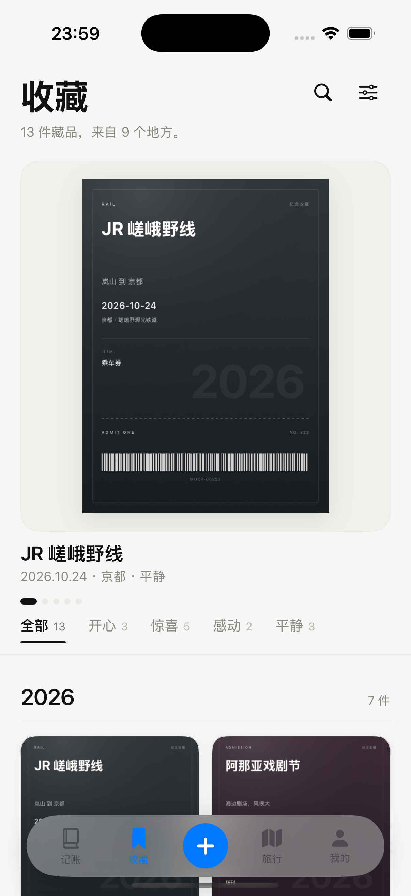
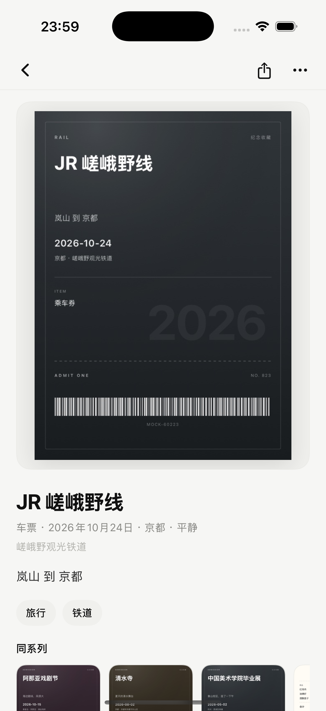
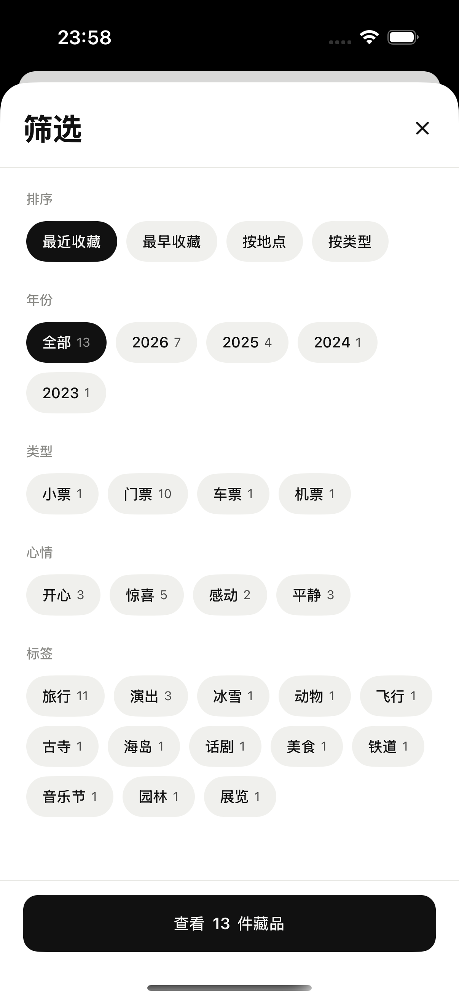
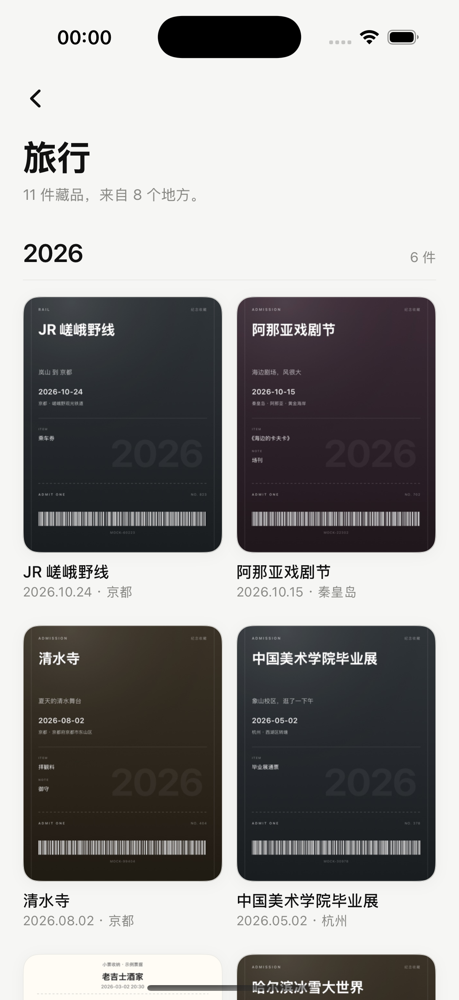
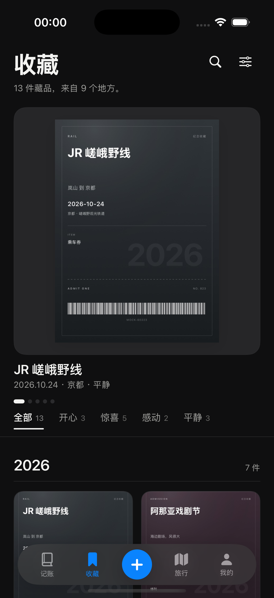

# 收藏馆 · 视觉与交互设计

> 状态：已实现 · 验证机：iPhone 16 Pro / iOS 18.3 · 版本：v2（现代画廊）· 2026-11-02

## 1. 方向

上一版把收藏做成「纸质档案」：米灰纸、宋体编号、朱红印章、撕口存根。装饰太多、色调偏旧。

v2 换成**克制的现代画廊**：

- **界面只留黑白灰**，不再加纸纹、印章、撕口、衬线编号；
- **颜色交给票根本身**，界面退到图片后面；
- 只用圆角图片 + 大字 + 留白建立层级，一个页面里最多两种圆角；
- 文案只保留必要信息：标题、日期、地点、心情，不写「本期典藏」「入藏」「No.」这类档案腔。

## 2. 视觉系统

### 2.1 色

| 名称 | Light | Dark | 用途 |
|---|---|---|---|
| background | `#F6F6F4` | `#0F0F10` | 页面底色（中性近白，不偏米/绿） |
| surface | `#FFFFFF` | `#1A1A1C` | 筛选 sheet、需要抬起的表面 |
| fill | `#F0F0ED` | `#262628` | 图片衬底、胶囊底 |
| ink | `#111111` | `#F3F3F1` | 标题、正文、选中反白 |
| secondary | `#8A8A86` | `#9B9B98` | 日期、地点、辅助说明 |
| tertiary | `#B6B6B1` | `#6B6B69` | 占位、页脚 |
| hairline | `#E9E9E5` | `#2B2B2D` | 0.6pt 分隔线 |

没有强调色。选中态用**墨色反白**（黑底白字 / 白底黑字），唯一的颜色来自票根图片。

### 2.2 字

- 全部使用系统字体（PingFang SC / SF Pro）；
- 页面标题 36pt Bold，字距 -0.8；
- 专题标题 32pt Bold；详情标题 26pt Bold；
- 卡片标题 14–19pt Medium/Semibold；说明 11.5–13pt Regular，用灰色分层；
- 不再使用衬线数字和全大写英文标签。

### 2.3 形

- 图片圆角 18（精选）/ 14（网格）/ 12（同系列小图）；
- 只有图片容器带圆角，文字、标签、按钮不套卡片；
- 胶囊只用于筛选与标签，选中时反白，未选中是浅灰底；
- 阴影很轻（0.04–0.06），只让图片从底色上浮起来。

## 3. 页面

### 3.1 收藏目录

```
收藏                              [搜索] [筛选•]
13 件藏品，来自 9 个地方。

┌──────────────────────────────┐
│                              │
│         [ 票根 / 照片 ]       │   ← 精选大图，浅灰衬底
│                              │
└──────────────────────────────┘
JR 嵯峨野线
2026.10.24 · 京都 · 平静
▬ ● ● ● ●

全部 13   开心 3   惊喜 5   感动 2   平静 3   ← 吸顶
────────────────────────────────────────────
2026                                     7 件
┌────────┐  ┌────────┐
│  图片   │  │  图片   │   ← 两列等宽，圆角 14
└────────┘  └────────┘
JR 嵯峨野线   阿那亚戏剧节
2026.10.24   2026.10.15 · 秦皇岛
...
标签  旅行 11  演出 3  冰雪 1 ...
共 13 件藏品
```

- 精选一屏一件，图在上、标题与日期在下；用一横排小点表示位置；
- 心情索引吸顶：文字 + 数量，选中项一条墨线滑过去；不做彩色胶囊；
- 网格按年份分组，年份 22pt Semibold + 件数，下接 0.6pt 发丝线；
- 筛选生效时在标题下出现一行「2026 年 × / 清除」，不再堆满 page 的 token；
- 页尾标签是一组浅灰胶囊，点进专题。

### 3.2 筛选

- 白色大 sheet，标题「筛选」，右上角关闭；
- 排序 / 年份 / 类型 / 心情 / 标签五段，全部用同一款胶囊；
- 改动先落在草稿上，底部「查看 N 件藏品」才生效；下滑关闭等于放弃；
- 结果为空时按钮变淡并禁用。

### 3.3 专题

- 从标签进入；返回箭头 + 32pt 标签名 + 一句「N 件藏品，来自 M 个地方」；
- 直接按年份铺同一个网格，不做样片墙、不加额外装饰。

### 3.4 藏品详情

- 白色画页：顶部 44pt 返回 / 分享 / 更多（无底色圆钮）；
- 图片放在浅灰衬底、18 圆角容器里，多图横向翻页，底部小圆点；
- 标题 26pt Bold，下面一行「类型 · 日期 · 地点 · 心情」，再下一行详细地址；
- 备注作为普通段落；标签是浅灰胶囊，可点进专题；
- 底部「同系列」横向小卡；
- 进入详情 / 专题时自动收起悬浮 Tab 栏，回到目录恢复。

### 3.5 搜索

- 顶部灰色圆角搜索框 + 取消；
- 空搜索时给「试试这些标签」，点一下直接搜；
- 结果是一行件数 + 无年份分组的纯网格，减少层级。

## 4. 示例票根

示例数据里的纪念收藏（门票 / 车票 / 机票）会在本地画成**低饱和色的票根**：

- 墨绿、靛蓝、梅子、石墨、栗棕五组暗色渐变；
- 白色大字标题、日期、地点、项目、条码；
- 超大的年份做 5% 透明度水印；
- 每张票有轻微白描边与内框，像实体票。

这样做只是为了让空库首启时收藏馆有内容可看；真实数据仍然使用用户扫描/拍摄的票据照片，界面不依赖这些颜色。

## 5. 交互与状态

- 心情筛选、标签、筛选应用都有轻触觉反馈；
- 吸顶心情条 + 状态栏遮罩：滚动时内容不会穿到时间后面；
- 搜索态、详情/专题态收起悬浮 Tab 栏；
- 深色模式整体反转，票根在深色页上仍然可读；
- 空状态：一张淡灰图标 + 一句话 +「去添加一张」；
- 无筛选结果：「清除筛选」。

## 6. 文件

| 文件 | 职责 |
|---|---|
| `CollectionView.swift` | 目录页 + 搜索 + 筛选入口 |
| `CollectionStyle.swift` | 黑白灰 token、状态栏遮罩、胶囊、按压反馈 |
| `CollectionModels.swift` | 编目模型、筛选、排序、年份分组、专题、同系列 |
| `CollectionComponents.swift` | 精选大图、心情索引、网格卡片、标签、空状态 |
| `CollectionFilterSheet.swift` | 筛选页 |
| `CollectionAlbumView.swift` | 专题页 |
| `CollectionDetailView.swift` | 藏品详情页 |
| `MockData.swift` | 示例票据 + 纪念票根绘制 |

## 7. 验证

- iPhone 16 Pro / iOS 18.3 模拟器；
- 浅色与深色、目录、筛选、专题、详情、搜索、筛选生效态均已截图核对；
- 记账 / 旅行 / 我的页面未改视觉；仅「恢复默认数据」的示例数量文案改为 20 条。

### 截图

| 目录 | 详情 |
|---|---|
|  |  |

| 筛选 | 专题 |
|---|---|
|  |  |

| 深色模式 |
|---|
|  |
